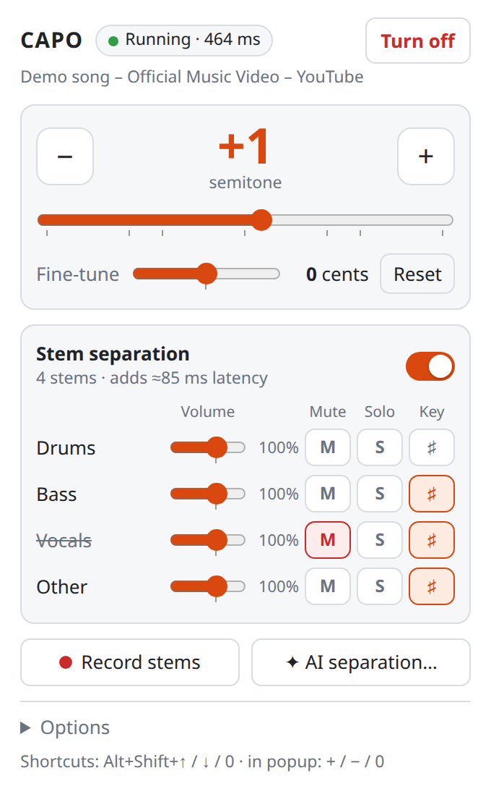
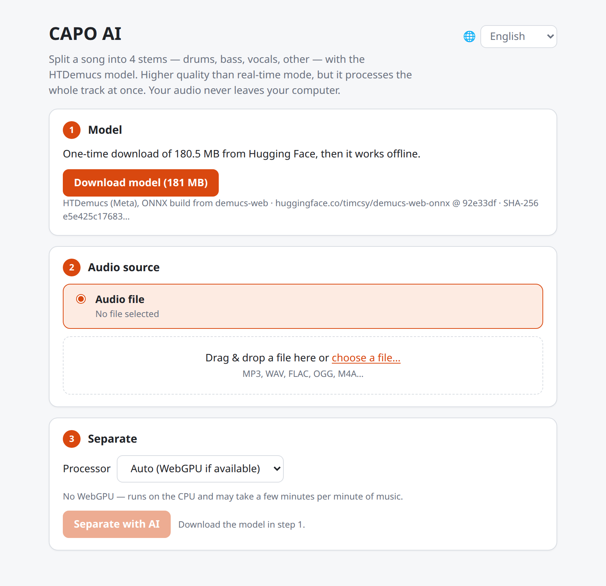

# CAPO

**Transpose the audio of any Chrome tab — change the key, keep the tempo.**
Split it into stems (drums · bass · vocals · other), mix and transpose each stem separately, record everything to WAV, and run high-quality AI stem separation on your recordings — all locally in the browser.

<p align="center">
  
  &nbsp;&nbsp;
  
</p>

> Status: prototype (v0.4.0). Unpacked Chrome extension, Manifest V3, Chrome 116+.

---

## Features

| | |
|---|---|
| **Pitch shift without tempo change** | −12…+12 semitones plus ±50 cents fine-tuning, powered by [Signalsmith Stretch](https://signalsmith-audio.co.uk/code/stretch/) (AudioWorklet + WASM). At 0 semitones the audio is passed through untouched. |
| **Real-time stem separation** | Drums · bass · vocals · other, with a custom DSP separator written in Rust → WASM (SIMD). Per-stem volume (0–150 %), mute, solo, and a per-stem *transpose* switch — by default drums keep their original pitch. |
| **Record to WAV** | Records the mix and each stem (16-bit stereo) straight to disk (OPFS), so long recordings don't fill RAM. Saved to `Downloads/CAPO/<tab title> <time>/`. |
| **AI stem separation** | A separate page runs Meta's HTDemucs (ONNX Runtime Web, WebGPU with CPU fallback) on your latest recording or any audio file, in a Web Worker. Higher quality, not real-time. |
| **Languages** | English (default) and Vietnamese, switchable at any time. |
| **Private** | All processing happens on your computer. The only network request is the one-time AI model download, which you start yourself. |

## Install

1. Open `chrome://extensions` and turn on **Developer mode**.
2. Click **Load unpacked** and select this folder.
3. Pin CAPO from the 🧩 menu.

For development there is also a one-liner that opens a separate Chrome window (own profile in `~/.cache/capo-dev-chrome`) with CAPO already loaded:

```bash
node scripts/dev-chrome.mjs [url]
```

After editing code, click ↻ **Reload** on the CAPO card in `chrome://extensions`.

## Usage

### Popup

1. Play something in a tab (YouTube, SoundCloud, a web player…), open the popup and click **Turn on** — or just move the slider.
2. Change the key with **−** / **+**, the slider (ticks at ±5, ±7, ±12) and **Fine-tune** (double-click to reset). **Reset** returns to the original key.
3. The status pill shows *Off*, *Running · latency* or *Recording m:ss*. **Turn off** gives the tab its original audio back.

| Control | What it does |
|---|---|
| **Stem separation** switch | Splits the tab into 4 stems (adds ≈85 ms latency). |
| Stem volume | 0–150 %; double-click resets to 100 %. |
| **M** / **S** | Mute / solo a stem. Silent stems are shown struck through. |
| **♯** | Whether this stem follows the transpose slider. |
| **Record stems** | Records the mix (+ each stem when separation is on). **Stop & save** downloads the WAV files. If the tab is closed while recording, what was recorded is still saved. |
| **✦ AI separation…** | Opens the CAPO AI page. |
| **Options** | Language, processing mode, formant preservation, vocal focus. |

**Processing modes**

| Mode | Transpose latency | With stem separation |
|---|---|---|
| High quality (default) | ~120 ms | ~205 ms |
| Low latency (for video) | ~60 ms | ~113 ms |
| Save CPU (pitch shift only) | ~140 ms | ~225 ms |

Add your audio device's own latency. The video is not delayed, so the sound lags the picture by that amount.

**Vocal focus** (2–24, default 12): higher values make the vocal stem cleaner, at the risk of leaving some vocals in other stems.

### Keyboard shortcuts

| Where | Keys |
|---|---|
| Anywhere (on the active tab) | `Alt+Shift+↑` / `Alt+Shift+↓` / `Alt+Shift+0` — change at `chrome://extensions/shortcuts` |
| Inside the popup | `+` / `−` / `0` |

### CAPO AI page

1. **Model** — download it once (181 MB from Hugging Face). It is verified with SHA-256 and stored locally; you can cancel or delete it.
2. **Audio source** — your latest CAPO recording, or drag & drop / choose any audio file (MP3, WAV, FLAC, OGG, M4A…).
3. **Separate** — runs on WebGPU if available, otherwise on the CPU. You can stop at any time; the page stays responsive.
4. Preview each stem and download one or all (`Downloads/CAPO/AI/…`).

### Language

*Options → 🌐 Language* in the popup, or the 🌐 menu on the AI page. English is the default. Changing it in one place updates every open CAPO page. The extension name/description and shortcut descriptions follow Chrome's own UI language (`_locales/`), as Chrome requires.

## How it works

```
popup / shortcuts ──msg──▶ background.js (service worker) ── chrome.downloads (WAV files)
                             ├─ chrome.tabCapture.getMediaStreamId(tab)
                             └─ chrome.offscreen document (USER_MEDIA)
                                        │
                                        ▼
offscreen.js → audio/engine.js (one AudioContext per tab):

  no separation:     tab ─▶ [Stretch | Delay] ─▶ speakers
  separation:        tab ─▶ Separator ─▶ stem ─▶ volume ─┬─▶ shared Stretch ─▶ speakers   (transposed stems)
                                                        └─▶ shared Delay   ─▶ speakers   (original-key stems)
  recording stems:   tab ─▶ Separator ─▶ stem ─▶ [Stretch | Delay] ─▶ tap ─▶ volume ─▶ speakers (+ "mix" tap)
```

- **One shared Stretch.** All transposed stems use the same key, so they share one pitch shifter. Per-stem shifters exist only while recording (each stem file must be post-transpose) and are dropped afterwards.
- **Bypass at 0 semitones.** A Delay with exactly the Stretch latency replaces it: output equals input, and the idle Stretch costs nothing (a small patch to Signalsmith, marked `CAPO patch`).
- **Sample-accurate alignment.** Stretch and Delay paths have identical latency, so stems stay aligned and switching paths never shifts the beat. Routing is declarative (`route()` → `Wiring` applies only the diff); retired nodes keep playing their tail for 0.5 s; reused Delays are recreated and Stretches reset so stale audio is never replayed.

### Stem separator (Rust/WASM, `dsp/`)

One STFT; every frequency bin is split by masks that sum to 1:

| Stem | Mask | Idea |
|---|---|---|
| Drums | `d = 1 / (1 + (β²·H/P)^s)` | Median-filter HPSS (Fitzgerald 2010): percussion is a *vertical* line in the spectrogram, pitched sound a *horizontal* one |
| Bass | `(1−d) · low(f)` | Pitched content below ≈180 Hz |
| Vocals | `(1−d) · band(f) · ψ^γ` | Pitched content in the *center* of the stereo image: ψ = 2·Re(S_LR)/(S_LL+S_RR) |
| Other | the rest | delayed input − the 3 stems above |

Because "other" is computed by subtraction, **the 4 stems always sum back to the input** (measured error 3·10⁻⁸). Masks are shared by both channels, only 3 inverse FFTs run per frame, nothing is allocated in the audio callback, and there is no wasm-bindgen glue — the worklet calls the C ABI (`sep_*`) directly. Parameters were chosen with `dsp/build.sh tune` on a synthetic stereo mix.

### AI separation

`ai.html` decodes and resamples the audio to 44.1 kHz on the main thread, then transfers it (zero-copy) to `workers/ai-worker.js`, which runs HTDemucs through ONNX Runtime Web and the [demucs-web](https://github.com/timcsy/demucs-web) pre/post-processing in ~7.8 s segments and returns one WAV per stem. ONNX Runtime is never loaded on the main thread.

The model (`htdemucs_embedded.onnx`) is pinned to commit `92e33df` of `huggingface.co/timcsy/demucs-web-onnx` and checked against its size (180,534,758 bytes) and SHA-256 (`e5e425c1…`) before use. Hugging Face serves CORS headers, so no host permission is needed.

## Performance

Measured with `OfflineAudioContext` (20 s of audio):

| Case | Speed |
|---|---|
| Transpose, no separation | 65× real time |
| No separation, 0 semitones (bypass) | 735× |
| Stem separation, 3 transposed stems | 30× (≈3 % of one CPU core) |
| Stem separator alone | 57× |
| AI separation, CPU, single thread | ≈0.35× real time (a 4-minute song takes ≈11 minutes; WebGPU is much faster) |

## Development

### Requirements

- Google Chrome 116+ (tests use `google-chrome`; set `CHROME=/path/to/chrome` to change it)
- Node.js (test runners and the dev script; no npm dependencies)
- Rust with the `wasm32-unknown-unknown` target — only if you rebuild the DSP

### Project layout

| Path | Purpose |
|---|---|
| `manifest.json` | MV3 manifest |
| `background.js` | Service worker: routing, per-tab locks, badge, downloads |
| `offscreen.js` | Holds the tab `MediaStream` + `AudioContext` per tab |
| `popup.*` | Popup UI |
| `ai.*` | CAPO AI page |
| `i18n.js` · `_locales/` | Translations (UI) · extension name/description |
| `presets.js` | Quality presets, default options, option merging |
| `audio/engine.js` | Audio graph (shared by the extension and the tests) |
| `audio/separator-node.js` · `worklets/separator-processor.js` | Stem separator node / AudioWorklet |
| `audio/recorder.js` · `worklets/recorder-processor.js` | Multi-track WAV recorder (OPFS) |
| `audio/ai-model.js` | Model download, verification and storage; audio decoding |
| `audio/ai-client.js` · `workers/ai-worker.js` · `audio/ai-separator.js` | AI separation in a Web Worker |
| `dsp/` | Rust crate `capo-dsp` (stem separator) |
| `wasm/capo_dsp.wasm` | Built `dsp/` (SIMD128, no imports) |
| `lib/` | Third-party code (see below) |
| `tests/` | Test suites |
| `scripts/dev-chrome.mjs` | Opens a dev Chrome window with CAPO loaded |
| `icons/` | Icon: a musical sharp sign (♯). `icon.svg` (48 px+), `icon-128.svg` (Chrome's 96 px artwork + 16 px padding), `icon-small.svg` (16–32 px, tuned to a 16 px grid); PNGs rendered from these |

### Build the DSP

```bash
rustup target add wasm32-unknown-unknown   # once
cd dsp
./build.sh          # → ../wasm/capo_dsp.wasm
./build.sh test     # Rust unit tests
./build.sh tune     # parameter tuning table
```

Cargo's build directory is `~/.cache/capo-dsp-target`, outside the extension folder.

### Tests

```bash
node tests/run.mjs          # audio engine in headless Chrome, same CSP as the extension
node tests/capture-e2e.mjs  # end-to-end: real tab capture → separation → +2 semitones → record → download → measure Hz
```

`tests/run.mjs` covers:

| Section | Checks |
|---|---|
| `separator` | 4 stems sum to the delayed input; latency exact to the sample |
| `stemRouting` | centered tone → vocals, left-panned tone → other, low tone → bass, clicks → drums |
| `alignment` | measured latency equals reported latency (Delay and Stretch paths, with and without separation) |
| `bypassAndSharing` | 0 semitones ⇒ output equals delayed input; number of running Stretches per mode (0 / 1 / 3 while recording) |
| `pitch` | 440 Hz sine through −12…+12 semitones in every mode, error < 0.5 % |
| `tempo` | a 0.5 s beat is still 0.5 s after transposing |
| `drumsKeepPitch` | snare spectral centroid ×1.38 when transposed, ×1.02 when drums keep their key |
| `stemControls` | mute/solo (> 15 dB), 50 % volume (−6 dB), per-stem transpose |
| `recording` | 5 valid WAV files; stems sum to the mix (≤ 4 LSB) |
| `benchmark` | render speed vs. real time |

`capture-e2e` uses Chrome's `--allowlisted-extension-id` switch so tab capture works without clicking the toolbar icon. If Chrome reports `Socket path too long`, run the tests with `TMPDIR=/tmp`.

## Permissions

| Permission | Why |
|---|---|
| `tabCapture`, `activeTab` | Capture the audio of the tab you turn CAPO on for |
| `offscreen` | Run the audio engine in an offscreen document (MV3 service workers have no audio) |
| `storage` | Remember options and language |
| `downloads` | Save recordings and AI stems |

No host permissions. No analytics. Audio never leaves your computer.

## Known limitations

- **DSP separation is approximate.** "Vocals" means *pitched and centered in the stereo image*: lead guitars/synths panned center and bass harmonics can land there; on mono tracks (the popup warns you) almost everything does. Wide, reverb-heavy or double-tracked vocals partly end up in "other". Pitched drums (toms, 808 kicks) are partly treated as pitched.
- **AI separation is not real-time** and is slow without WebGPU. The CPU path is single-threaded: enabling cross-origin isolation (needed for multi-threading) breaks Chrome tab capture — the offscreen document moves to another process and `getUserMedia` fails with `Error starting tab capture`.
- Can't capture `chrome://` pages or the Chrome Web Store; DRM-protected audio may be silent.
- One capture per tab: another extension capturing the same tab will conflict.
- Audio plays through the system default output device, not the tab's own device.

## Third-party code

| Component | License |
|---|---|
| [Signalsmith Stretch](https://signalsmith-audio.co.uk/code/stretch/) 1.3.2 — `lib/SignalsmithStretch.mjs` | MIT © Geraint Luff (with one small patch, see `lib/SignalsmithStretch.SOURCE.txt`) |
| [ONNX Runtime Web](https://github.com/microsoft/onnxruntime) 1.31.1 — `lib/onnxruntime-web/` | MIT © Microsoft |
| [demucs-web](https://github.com/timcsy/demucs-web) 1.0.2 — `lib/demucs-web/` | MIT |
| [realfft](https://crates.io/crates/realfft) 3.5 (compiled into `wasm/capo_dsp.wasm`) | MIT |
| [rustfft](https://crates.io/crates/rustfft) 6.4 and its dependencies (compiled into `wasm/capo_dsp.wasm`) | MIT OR Apache-2.0 |
| HTDemucs model (downloaded at runtime, not bundled) | Based on [facebookresearch/demucs](https://github.com/facebookresearch/demucs) (MIT); the Hugging Face repository does not state a separate license |

## License

MIT — see [LICENSE](LICENSE). Third-party components keep their own licenses (above).
